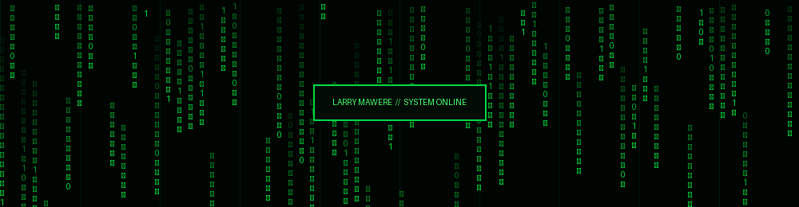

<div align="center">



# `LARRY MAWERE`

### CYBERSECURITY • SOFTWARE ENGINEERING • TECHNOLOGY


</div>

---

<table>
<tr>
<td width="38%" align="center" valign="top">


**LARRY'S TERMINAL**

`USER: LarryMawere`

`STATUS: ACTIVE`

`ACCESS: GRANTED`

</td>
<td width="62%" valign="top">

### `SYSTEM.INFORMATION`

```yaml
Name: Larry Mawere
Username: LarryMawere
Environment: Windows / Linux
Location: Warsaw, Poland

Education:
  Degree: Computer Science
  Specialization: Cybersecurity

Current_Focus:
  - Cybersecurity
  - Software Engineering
  - Cloud & DevOps
  - Network Security

Status: Building & Learning
```

### `PROGRAMMING.LANGUAGES`


### `TECHNOLOGIES`


</td>
</tr>
</table>

---

### `CYBERSECURITY.MODULES`

```text
[+] Network Security
[+] Penetration Testing
[+] Vulnerability Assessment
[+] Risk Management
[+] ISO 27001
[+] SIEM & Log Monitoring
[+] Infrastructure Security
```

### `CURRENT.PROJECTS`

| ID | Project |
|---|---|
| 01 | Credit Card Processing Security Assessment |
| 02 | Spring Boot Applications |
| 03 | Network Infrastructure & Security |
| 04 | Cloud & DevOps |
| 05 | Software Engineering Projects |

---

### `GITHUB.STATISTICS`

<div align="center">


</div>

---

### `CONTACT.INFORMATION`

<div align="center">

<a href="https://github.com/LarryMawere">
  
</a>
<a href="https://www.linkedin.com/in/larry-mawere-723b99221">
  
</a>

</div>

---

<div align="center">

```text
[ SYSTEM MESSAGE ]

KEEP LEARNING.
KEEP BUILDING.
KEEP SECURING.

> ACCESS GRANTED_
```

**`LARRY MAWERE © 2026`**

</div>
